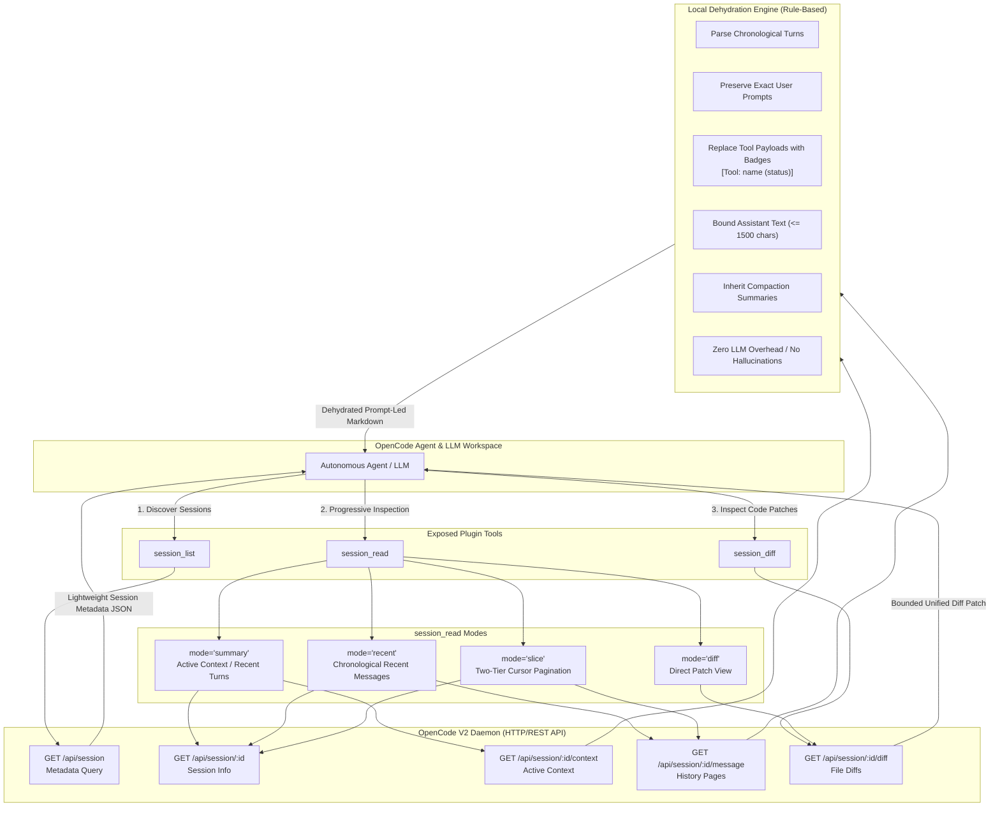

[English](README.md) | [简体中文](README.zh.md)

# opencode-session-reader

> Native OpenCode V2 plugin for cross-session discovery, inspection, and context resumption, inspired by OpenAI Codex thread architecture.

[](LICENSE)
[](https://www.npmjs.com/package/opencode-session-reader)
[](https://github.com/zjm54321/opencode-session-reader/actions/workflows/ci.yml)

---

## Table of Contents

- [Why This Was Designed](#why-this-was-designed)
  - [The Context Flood Problem](#the-context-flood-problem)
  - [The Attention Drift Challenge](#the-attention-drift-challenge)
  - [The Solution: Progressive Disclosure](#the-solution-progressive-disclosure)
- [Architecture & Design Philosophy](#architecture--design-philosophy)
  - [Comparison with OpenAI Codex Thread Architecture](#comparison-with-openai-codex-thread-architecture)
  - [1. Decoupled Metadata Indexing](#1-decoupled-metadata-indexing)
  - [2. Deprecating Full-History Hydration](#2-deprecating-full-history-hydration)
  - [3. Zero-LLM Overhead Rule-Based Dehydration](#3-zero-llm-overhead-rule-based-dehydration)
  - [4. Two-Tier Cursor-Based Pagination Isolation](#4-two-tier-cursor-based-pagination-isolation)
- [Mermaid Architecture Workflow](#mermaid-architecture-workflow)
- [Tools Exposed to Agents](#tools-exposed-to-agents)
  - [1. session_list](#1-session_list)
  - [2. session_read](#2-session_read)
  - [3. session_diff](#3-session_diff)
- [Installation & Setup](#installation--setup)
  - [Option 1: Via npm (Recommended)](#option-1-via-npm-recommended)
  - [Option 2: Local Development Link](#option-2-local-development-link)
- [Development & Testing](#development--testing)
  - [Development Commands](#development-commands)
  - [Automated Test Suite](#automated-test-suite)
- [License](#license)

---

## Why This Was Designed

In complex software engineering workflows, tasks are rarely completed in a single continuous session. Developers and AI agents routinely need to:
1. **Resume unfinished work**: Pick up an incomplete task or complex refactor from a previous session without starting from scratch.
2. **Reference historical decisions**: Verify architectural choices, bug triage records, or root-cause analyses conducted days or weeks earlier.
3. **Branch explorations**: Spin off an alternative technical spike while retaining critical learnings from a prior attempt.

### The Context Flood Problem

Traditional attempts at cross-session resumption usually swing between two problematic extremes:

- **Extreme A: The Naive Full Dump**  
  Feeding entire raw message logs from a previous session into the current LLM context. Because real-world coding sessions accumulate massive tool outputs (compiler diagnostics, multi-megabyte test runs, full file reads, shell stdout/stderr, and mega git diffs), a single session frequently exceeds 100,000+ tokens. Dumping it verbatim:
  - Overwhelms the context window, leaving minimal headroom for new work.
  - Multiplies inference costs exponentially on every subsequent interaction.
  - Drastically degrades response latency.
  - Induces severe model confusion through the well-documented **Lost in the Middle** phenomenon.

- **Extreme B: The Naive Slice ("Last 5 Messages")**  
  Blindly truncating history to the trailing messages. This loses the initial user requirements, the underlying rationale for architectural decisions, acceptance constraints, and the list of modified files.

### The Attention Drift Challenge

When thousands of lines of raw terminal logs and tool payloads saturate the context window, self-attention mechanisms become diluted. Transformer models struggle to distinguish critical user requirements from transient runtime noise. This leads to hallucinated requirements, repeated failed attempts, and lost focus.

### The Solution: Progressive Disclosure

`opencode-session-reader` solves these challenges through a **progressive-disclosure, context-protective architecture** built natively on OpenCode V2. It allows agents to discover sessions by lightweight metadata, read dehydrated conversational turns on demand, and inspect code diffs separately—protecting the context window while retaining essential technical signal.

---

## Architecture & Design Philosophy

The design of `opencode-session-reader` is informed by deep reverse-engineering of **OpenAI Codex's thread-management system**.

### Comparison with OpenAI Codex Thread Architecture

| Design Dimension | OpenAI Codex Threads | Traditional OpenCode Session Resumption | `opencode-session-reader` |
|---|---|---|---|
| **Discovery** | `thread/list` returns metadata only | Dumps raw session files | Decoupled metadata query (`session_list`) |
| **History Loading** | Full hydration deprecated for long threads | Full raw history dumped | Deprecated full hydration; progressive slicing |
| **Tool Payload Handling** | Ephemeral, omitted from thread summary | Serialized completely into context | Deterministic rule-based badge dehydration |
| **Summarization Overhead** | Background server-side compaction | Heavy secondary LLM calls | Zero LLM overhead; deterministic local engine |
| **Pagination** | Opaque cursor-based forward/backward | Line-based or non-paginated | Two-tier base64 cursor pagination isolation |

### 1. Decoupled Metadata Indexing

Like Codex's `thread/list`, session discovery is decoupled from session content. Calling `session_list` queries OpenCode's relational session database and returns only lightweight metadata:
- Unique session ID (`id`)
- Human-readable session title (`title`)
- Workspace directory path (`directory`)
- Parent session identifier (`parentID`)
- Last update timestamp (`updated`)

No conversation bodies, tool results, or code diffs are preloaded during discovery.

### 2. Deprecating Full-History Hydration

In Codex's official protocol definitions, full-history hydration is explicitly flagged as deprecated for long threads. `opencode-session-reader` adopts this principle: agents cannot accidentally dump an entire 100k-token session into their active context. Instead, agents navigate past work through four disciplined modes: `summary`, `recent`, `slice`, and `diff`.

### 3. Zero-LLM Overhead Rule-Based Dehydration

Many third-party plugins attempt to summarize prior sessions by calling a secondary LLM. That approach introduces significant latency, incurs extra token bills, and risks hallucinating technical details or dropping subtle constraints.

`opencode-session-reader` employs a **deterministic, rule-based local dehydrator**:
- **Tool Outputs**: Replaced with clean status badges: `[Tool: <name> (<status>)]`. If a tool failed, a compact error snippet (up to 200 characters) is appended. Raw megabyte logs and stdout dumps are completely eliminated.
- **User Prompts**: Preserved verbatim to guarantee that original user intent, edge-case constraints, and business requirements remain completely intact.
- **Assistant Conclusions**: Text blocks are cleanly extracted and bounded with safe character thresholds (up to 1,500 characters per block).
- **Compaction Nodes**: If the original session was compacted by OpenCode's `/compact`, the plugin seamlessly inherits and renders the system compaction summary (`### Compaction summary`).
- **Zero Hallucinations**: Because no secondary LLM is invoked during dehydration, every output is 100% faithful to the actual event history.

### 4. Two-Tier Cursor-Based Pagination Isolation

The plugin leverages OpenCode's native opaque base64 cursors (`previous` and `next`). Sorting parameters (`order: asc | desc`) and pagination cursors are cleanly isolated:
- Requesting an explicit cursor automatically defers ordering to the cursor state.
- Chronological (`asc`) and reverse-chronological (`desc`) directions are handled safely without infinite loops or duplicate page boundaries.

---

## Mermaid Architecture Workflow

The following diagram illustrates how an agent interacts with `opencode-session-reader`, the local dehydration engine, and the underlying OpenCode V2 daemon:



---

## Tools Exposed to Agents

When this plugin is loaded, OpenCode automatically registers three tools into the agent's catalog:

### 1. `session_list`

Discovers and filters historical OpenCode sessions across workspaces or within the current project.

#### Parameters

| Parameter | Type | Default | Description |
|---|---|---|---|
| `search` | `string` | `undefined` | Substring keyword to search within session titles. When set, searches across all directories by default. |
| `directory` | `string` | Current workspace | Explicit workspace directory to filter sessions. Overrides the default workspace directory. |
| `all` | `boolean` | `false` | When `true`, searches sessions across all projects on this machine. |
| `limit` | `number` | `20` | Maximum number of sessions to return per page (1–100). |
| `order` | `"asc" \| "desc"` | `"desc"` | Sort by session update time (newest first by default). Ignored if `cursor` is provided. |
| `cursor` | `string` | `undefined` | Opaque base64 pagination cursor returned from a previous query for navigating next/previous pages. |

#### Return Value

Returns a formatted JSON array of session descriptors followed by opaque pagination metadata:
```json
[
  {
    "id": "ses_01j9b2x3k4m5n6p7q8r9s0t1u2",
    "title": "Refactor database migration pipeline",
    "directory": "/home/user/projects/backend",
    "parentID": undefined,
    "updated": 1718000000000
  }
]

Pagination: {"next": "eyJvZmZzZXQiOjIwfQ==", "previous": null}
```

#### Example Usage

```json
{
  "search": "database migration",
  "limit": 10,
  "all": true
}
```

---

### 2. `session_read`

Reads compact conversational turns from a target session with automatic dehydration and context protection.

#### Parameters

| Parameter | Type | Default | Description |
|---|---|---|---|
| `sessionID` | `string` | **Required** | The target session ID (e.g. `ses_xxxx`). |
| `mode` | `"summary" \| "recent" \| "slice" \| "diff"` | `"summary"` | Reading mode governing which messages are fetched and how they are structured. |
| `limit` | `number` | Mode default | Maximum messages to retrieve (default: `12` for `summary`, `20` for `recent` and `slice`). |
| `cursor` | `string` | `undefined` | Opaque base64 pagination cursor returned from a previous read. |
| `order` | `"asc" \| "desc"` | Mode default | Sort order (`"asc"` for chronological, `"desc"` for reverse). Default: `"asc"` for `slice`, `"desc"` for `recent`. Ignored when `cursor` is present. |
| `type` | `string` | `undefined` | Optional message type filter (e.g. `"user"`, `"assistant"`) for `recent` and `slice` modes. |

#### Modes Explained

- **`summary` (Default)**: Fetches the active working context of the session (messages after the latest compaction boundary, taking the last 12 messages by default). Formats turns in chronological order with prompt-led grouping and collapsed tool badges.
- **`recent`**: Retrieves the latest conversational turns in chronological order (fetches descending from daemon, then safely reverses for turn analysis).
- **`slice`**: Pages through historical messages using pagination cursors without flooding context. Ideal for deep inspection of a specific historical interaction.
- **`diff`**: Quick shorthand that delegates to the diff engine, returning all file modifications made in the session.

#### Example Usage

```json
{
  "sessionID": "ses_01j9b2x3k4m5n6p7q8r9s0t1u2",
  "mode": "summary",
  "limit": 12
}
```

#### Output Structure

Dehydrated sessions are structured into prompt-led turns:
```markdown
# Refactor database migration pipeline

Session: ses_01j9b2x3k4m5n6p7q8r9s0t1u2
Directory: /home/user/projects/backend

## Turn 1

### User

Please migrate the users table to add a uuid column and update the index.

### Assistant

[Tool: read (completed)]

I have inspected schema.prisma. Adding the uuid column now.

[Tool: edit (completed)]

Database migration file generated and applied successfully.
```

---

### 3. `session_diff`

Inspects file diffs and patches produced during a session without reading conversation text.

#### Parameters

| Parameter | Type | Default | Description |
|---|---|---|---|
| `sessionID` | `string` | **Required** | Target session ID (e.g. `ses_xxxx`). |
| `file` | `string` | `undefined` | Optional relative file path filter. When provided, returns the diff only for that specific file. |

#### Safety Guarantees

- **24,000-Character Upper Bound**: Output is bounded to 24,000 characters to prevent mega-diffs from blowing up the context window.
- **Dynamic Fence Escaping**: Code fences dynamically adjust length to ensure embedded backticks in diff content never prematurely terminate Markdown formatting blocks.

#### Example Usage

```json
{
  "sessionID": "ses_01j9b2x3k4m5n6p7q8r9s0t1u2",
  "file": "src/client.ts"
}
```

---

## Installation & Setup

### Option 1: Via npm (Recommended)

Add `opencode-session-reader@0.1.0` directly to your global or project-level `opencode.json` configuration file:

```json
{
  "$schema": "https://opencode.ai/config.json",
  "plugins": [
    "opencode-session-reader@0.1.0"
  ]
}
```

When OpenCode starts, it will automatically resolve, install, and initialize the plugin.

### Option 2: Local Development Link

For local plugin development or customization, clone the repository and build the distribution bundle:

```bash
git clone https://github.com/zjm54321/opencode-session-reader.git
cd opencode-session-reader
bun install
bun run build
```

Then reference the built distribution directory via a file URL in `opencode.json`:

```json
{
  "plugins": [
    "file:///path/to/opencode-session-reader/dist"
  ]
}
```

---

## Development & Testing

This project is built using [Bun](https://bun.sh) and optionally managed via [Nix Flakes](https://nixos.org).

### Development Commands

```bash
# 1. Enter the reproducible Nix development environment (optional)
nix develop

# 2. Install dependencies
bun install

# 3. Run unit and integration tests
bun test

# 4. Run strict TypeScript typecheck
bun run typecheck

# 5. Build distribution bundle
bun run build
```

### Automated Test Suite

The test suite consists of 17 automated tests covering the entire architecture:

- `tests/dehydrate.test.ts`: Verifies rule-based dehydration, user prompt preservation, tool badge collapsing, assistant text boundary enforcement (1,500 characters), compaction summary inheritance, and shell exit code handling.
- `tests/client.test.ts`: Verifies REST API query string serialization, credential reading from `~/.config/opencode/service.json`, timeout abort controllers, password redaction in error messages, and error diagnostics.
- `tests/integration.test.ts`: Live end-to-end integration against a running OpenCode daemon verifying `session_list`, `session_read` modes (`summary`, `recent`, `slice`, `diff`), `session_diff`, and cursor pagination continuation.

---

## License

This project is licensed under the **GNU General Public License v3.0 or later** ([GPL-3.0-or-later](LICENSE)).
