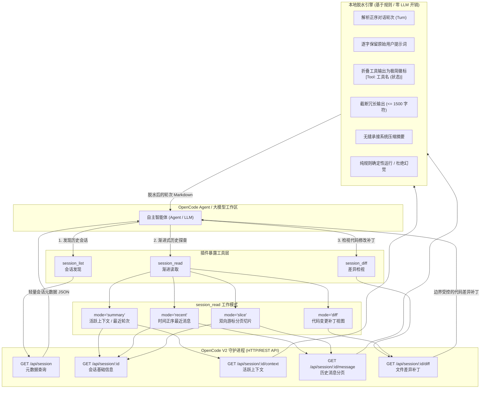

[English](README.md) | [简体中文](README.zh.md)

# opencode-session-reader

> 原生 OpenCode V2 插件，灵感源自 OpenAI Codex 线程架构，专为跨会话发现、历史检视与上下文平滑恢复打造。

[](LICENSE)
[](https://www.npmjs.com/package/opencode-session-reader)
[](https://github.com/zjm54321/opencode-session-reader/actions/workflows/ci.yml)

---

## 目录导航

- [为什么设计该插件](#为什么设计该插件)
  - [上下文泄洪痛点](#上下文泄洪痛点)
  - [注意力漂移挑战](#注意力漂移挑战)
  - [解决方案：渐进式披露](#解决方案渐进式披露)
- [架构设计哲学与 Codex 对比](#架构设计哲学与-codex-对比)
  - [与 OpenAI Codex 线程架构对比](#与-openai-codex-线程架构对比)
  - [1. 元数据解耦索引](#1-元数据解耦索引)
  - [2. 废弃全量水合](#2-废弃全量水合)
  - [3. 零额外 LLM 开销的本地规则脱水](#3-零额外-llm-开销的本地规则脱水)
  - [4. 两级游标分页隔离](#4-两级游标分页隔离)
- [Mermaid 架构流程图](#mermaid-架构流程图)
- [三大暴露工具详尽参考](#三大暴露工具详尽参考)
  - [1. session_list](#1-session_list)
  - [2. session_read](#2-session_read)
  - [3. session_diff](#3-session_diff)
- [安装与配置指南](#安装与配置指南)
  - [方式一：通过 npm 安装（推荐）](#方式一通过-npm-安装推荐)
  - [方式二：本地开发链接](#方式二本地开发链接)
- [开发与测试指令](#开发与测试指令)
  - [开发调试命令](#开发调试命令)
  - [自动化测试套件](#自动化测试套件)
- [开源协议声明](#开源协议声明)

---

## 为什么设计该插件

在真实的复杂软件工程中，开发任务极少能在单一对话会话中线性完成。开发者与 AI 智能体日常面临以下高频诉求：
1. **恢复未尽任务**：接续前序会话未完成的代码重构或功能演进，无需从零开始重新铺垫背景。
2. **追溯历史决策**：回顾数天前或数周前会话中制定的技术选型、架构权衡与缺陷根因分析记录。
3. **分支衍生探索**：基于先前会话的试错结论，开启一条全新的技术验证分支。

### 上下文泄洪痛点

传统跨会话恢复手段往往陷入两种极端的误区：

- **极端 A：粗暴的全量回灌（The Naive Full Dump）**  
  将前序会话的原始消息记录全盘灌入当前模型上下文。由于真实代码开发中积累了天量工具调用载荷（编译器诊断、几十兆的单元测试日志、整份文件读取内容、终端标准输出与海量 Git 差异补丁），单次长会话极易突破 10 万+ Tokens。直接全量回灌会带来灾难性后果：
  - 瞬间挤爆上下文窗口，导致后续交互空间所剩无几；
  - 后续每一轮对话的推理成本成倍暴涨；
  - 响应首字延迟显著升高；
  - 极易诱发大模型严重的**迷失在中间（Lost in the Middle）**现象，降低推理质量。

- **极端 B：粗暴的盲目截断（The Naive Slice，如“仅取最后 5 条消息”）**  
  仅盲目截取最后几条对话。这种做法会彻底丢失用户最初的需求目标、架构约束、边界条件以及文件修改全貌，使得智能体在断章取义的状态下产生方向偏移。

### 注意力漂移挑战

当数以万计的终端调试字符与原始工具调用输出淹没注意力机制时，Transformer 的自注意力头会被底层细碎噪音严重稀释，难以分辨核心业务诉求与瞬时运行时垃圾。这直接导致智能体注意力漂移、遗忘前序约定、产生幻觉甚至陷入重复试错的死循环。

### 解决方案：渐进式披露

`opencode-session-reader` 针对上述痛点，在 OpenCode V2 原生内核上构建了一套**渐进式披露（Progressive Disclosure）与上下文保护架构**。智能体先通过元数据轻量定位会话，按需调取脱水后的对话轮次，并根据需要独立查看文件补丁，从而在最大化节约 Token 的同时，精准提取关键历史决策信号。

---

## 架构设计哲学与 Codex 对比

`opencode-session-reader` 的架构灵感直接吸取自对 **OpenAI Codex 线程管理架构（Thread Architecture）** 的深度逆向与系统化借鉴：

### 与 OpenAI Codex 线程架构对比

| 设计维度 | OpenAI Codex Threads 线程机制 | 传统 OpenCode 恢复方式 | `opencode-session-reader` 方案 |
|---|---|---|---|
| **会话发现** | `thread/list` 仅返回元数据列表 | 机械式读取全量磁盘会话文件 | 元数据完全解耦查询（`session_list`） |
| **历史水合** | 官方协议显式废弃长线程全量水合 | 粗暴全量加载历史消息 | 严格废弃全量水合，提供模式化渐进切片 |
| **工具载荷** | 瞬态运行，摘要中彻底剔除工具明细 | 全量序列化庞大工具日志到上下文 | 确定性规则脱水，转换为极简状态徽标 |
| **摘要成本** | 依赖后端异步 Compaction 任务 | 依赖额外耗时且昂贵的二次 LLM 总结 | 零额外 LLM 开销，确定性本地规则脱水引擎 |
| **分页控制** | 不透明游标双向推进（Next/Prev） | 简单行号切片或不支持分页 | 严谨隔离的两级 Base64 游标双向分页 |

### 1. 元数据解耦索引

正如 Codex 系统的 `thread/list` 设计，会话发现过程与会话正文内容彻底解耦。智能体调用 `session_list` 时，仅向 OpenCode 关系型数据库查询轻量元数据：
- 唯一会话 ID（`id`）
- 语义化会话标题（`title`）
- 工作区目录路径（`directory`）
- 父级会话标识（`parentID`）
- 最终更新时间戳（`updated`）

在发现阶段绝不预先加载对话消息体、工具执行结果或代码 Diff，确保毫秒级极速响应与零上下文污染。

### 2. 废弃全量水合

在 Codex 的官方规范定义中，针对长会话的全量历史水合（Full-History Hydration）被明确列为已废弃设计。`opencode-session-reader` 严格践行这一准则：禁止任何工具将数十万 Tokens 的未加工对话一股脑载入上下文。取而代之的是 `summary`（活跃上下文）、`recent`（最近轮次）、`slice`（分页切片）与 `diff`（差异检视）四大安全模式，引导模型建立按需、渐进式的理解链路。

### 3. 零额外 LLM 开销的本地规则脱水

市面上部分方案尝试使用额外的次级大模型调用（Secondary LLM Calls）对历史会话进行“AI 摘要”。这种做法不仅带来高昂的额外 Token 账单与显著请求延迟，更致命的是常常引入模型幻觉——篡改代码关键细节、虚构执行状态或漏掉隐晦的架构约束。

`opencode-session-reader` 采用**确定性本地规则脱水引擎（Deterministic Rule-Based Dehydrator）**：
- **工具输出过滤**：原始控制台大段打印被彻底剔除，折叠为精炼的状态徽标 `[Tool: <name> (<status>)]`；若工具执行失败，仅提取至多 200 字符的错误诊断摘要。
- **用户提示词保真**：用户输入的内容不做任何删减，逐字保留，确保最初的意图、边界条件与业务约束零失真。
- **助手回复封顶**：提取助手的核心推导与结论文本，单块文本设置 1,500 字符安全上限，超长部分优雅截断。
- **承接压缩摘要**：当原会话被 OpenCode 原生 `/compact` 机制压缩过时，引擎直接无缝提取系统压缩总结（`### Compaction summary`）。
- **绝对零幻觉**：全过程由确定性 TypeScript 本地规则执行，零额外 LLM 消耗，百分之百忠于原始交互事实。

### 4. 两级游标分页隔离

插件深度对接 OpenCode 底层不透明 Base64 游标（`previous` 与 `next`）。排序逻辑与游标状态完全隔离：
- 一旦传入分页游标，系统自动以游标内部状态为准，避免显式排序与游标内置时序产生冲突；
- 严谨处理时间升序（`asc`）与时间倒序（`desc`）的翻页切换，确保智能体漫游深层历史记录时不会死循环或丢失边界数据。

---

## Mermaid 架构流程图

以下 Mermaid 流程图清晰呈现了智能体、暴露工具、读取模式、本地脱水引擎与 OpenCode V2 守护进程之间的完整数据流向：



---

## 三大暴露工具详尽参考

插件启动后，OpenCode 会自动在智能体的工具注册表中注入以下三大工具：

### 1. `session_list`

检索与过滤跨项目或当前工作区内的 OpenCode 历史会话。

#### 参数表

| 参数名 | 类型 | 默认值 | 说明 |
|---|---|---|---|
| `search` | `string` | `undefined` | 按会话标题检索子字符串关键字。设置后默认在跨目录范围搜索。 |
| `directory` | `string` | 当前工作区 | 显式指定筛选会话的工作区目录。该参数会覆盖默认工作区作用域。 |
| `all` | `boolean` | `false` | 当为 `true` 时，在整台机器的所有项目会话中检索。 |
| `limit` | `number` | `20` | 每页返回的最大会话数（取值范围 1–100）。 |
| `order` | `"asc" \| "desc"` | `"desc"` | 按会话更新时间排序（默认最新在前）。若提供了 `cursor` 则本项被忽略。 |
| `cursor` | `string` | `undefined` | 上一次查询返回的不透明 Base64 分页游标，用于向前或向后翻页。 |

#### 返回结构

返回轻量会话元数据 JSON 数组以及供后续翻页使用的分页游标：
```json
[
  {
    "id": "ses_01j9b2x3k4m5n6p7q8r9s0t1u2",
    "title": "重构数据库迁移脚本",
    "directory": "/home/ming/projects/backend",
    "parentID": undefined,
    "updated": 1718000000000
  }
]

Pagination: {"next": "eyJvZmZzZXQiOjIwfQ==", "previous": null}
```

#### 调用示例

```json
{
  "search": "数据库迁移",
  "limit": 10,
  "all": true
}
```

---

### 2. `session_read`

读取指定会话的紧凑轮次，具备自动化本地脱水与上下文保护机制。

#### 参数表

| 参数名 | 类型 | 默认值 | 说明 |
|---|---|---|---|
| `sessionID` | `string` | **必填** | 目标会话标识符（如 `ses_xxxx`）。 |
| `mode` | `"summary" \| "recent" \| "slice" \| "diff"` | `"summary"` | 读取工作模式（详见下方模式解析）。 |
| `limit` | `number` | 各模式默认值 | 最大读取消息条数（`summary` 默认 `12`，`recent` 与 `slice` 默认 `20`）。 |
| `cursor` | `string` | `undefined` | 上一次读取操作返回的不透明分页游标。 |
| `order` | `"asc" \| "desc"` | 各模式默认值 | 排序方向（时间正序 `"asc"` 或时间倒序 `"desc"`；`slice` 默认 `"asc"`，`recent` 默认 `"desc"`；提供 `cursor` 时忽略此项）。 |
| `type` | `string` | `undefined` | 针对 `recent` 和 `slice` 模式的可选消息类型筛选（如 `"user"`、`"assistant"`）。 |

#### 四大模式深度解析

- **`summary`（默认模式）**：获取当前会话的活跃工作上下文（即最新一次会话压缩节点之后的有效上下文，默认取最后 12 条）。按提示词主导组织轮次并自动将庞大工具载荷脱水为极简徽标。
- **`recent` 模式**：以时间正序拉取最近的一组对话轮次（底层倒序提取后精准反转，保障轮次解析符合人类直觉）。
- **`slice` 模式**：通过 Base64 游标向前或向后平稳切片遍历完整历史消息，单次消费完全受控，杜绝内存击穿。
- **`diff` 模式**：快捷别名模式，等效于直接调度代码差异解析引擎，直接获取该会话产出的所有文件修改补丁。

#### 调用示例

```json
{
  "sessionID": "ses_01j9b2x3k4m5n6p7q8r9s0t1u2",
  "mode": "summary",
  "limit": 12
}
```

#### 输出格式示例

脱水后的消息以结构清晰的轮次（Turn）呈现：
```markdown
# 重构数据库迁移脚本

Session: ses_01j9b2x3k4m5n6p7q8r9s0t1u2
Directory: /home/ming/projects/backend

## Turn 1

### User

请为 users 表添加 uuid 字段，并补充唯一索引。

### Assistant

[Tool: read (completed)]

已检查 schema.prisma。现在添加 uuid 字段与对应索引。

[Tool: edit (completed)]

数据库迁移文件已生成并成功执行。
```

---

### 3. `session_diff`

跳过聊天会话正文，专项检视指定会话中所产生的文件修改与 Git 补丁。

#### 参数表

| 参数名 | 类型 | 默认值 | 说明 |
|---|---|---|---|
| `sessionID` | `string` | **必填** | 目标会话标识符（如 `ses_xxxx`）。 |
| `file` | `string` | `undefined` | 可选的单一文件相对路径。传入后仅检视该特定文件的差异补丁。 |

#### 安全保障设计

- **24,000 字符硬性上限**：Diff 总输出被严格限制在 24,000 字符以内，防止特大文件的巨型 Patch 爆破当前上下文。
- **动态防破坏代码围栏**：动态计算代码块反引号数量（` ``` `），确保即使 Diff 内容中包含反引号代码，也不会导致外层 Markdown 代码围栏提前闭合破损。

#### 调用示例

```json
{
  "sessionID": "ses_01j9b2x3k4m5n6p7q8r9s0t1u2",
  "file": "src/client.ts"
}
```

---

## 安装与配置指南

### 方式一：通过 npm 安装（推荐）

直接在全局或项目级 `opencode.json` 配置文件的 `plugins` 列表中添加 `opencode-session-reader@0.1.0`：

```json
{
  "$schema": "https://opencode.ai/config.json",
  "plugins": [
    "opencode-session-reader@0.1.0"
  ]
}
```

OpenCode 在启动时会自动下载、安装依赖并完成插件工具的注入注册。

### 方式二：本地开发链接

克隆本代码仓库并构建产物包：

```bash
git clone https://github.com/zjm54321/opencode-session-reader.git
cd opencode-session-reader
bun install
bun run build
```

在 `opencode.json` 中通过 `file://` 协议指向构建出的 `dist` 目录：

```json
{
  "plugins": [
    "file:///path/to/opencode-session-reader/dist"
  ]
}
```

---

## 开发与测试指令

本项目基于 [Bun](https://bun.sh) 运行时构建，并提供可复现的 [Nix Flakes](https://nixos.org) 开发环境。

### 开发调试命令

```bash
# 1. 进入可复现的 Nix 开发环境（可选）
nix develop

# 2. 安装项目依赖
bun install

# 3. 运行单元测试与集成测试
bun test

# 4. 执行严格的 TypeScript 类型检查
bun run typecheck

# 5. 构建生产分发包 (dist)
bun run build
```

### 自动化测试套件

项目包含 17 项端到端及模块级自动化测试，全方位覆盖核心逻辑：

- `tests/dehydrate.test.ts`：测试基于规则的脱水逻辑、用户提示词保真度、工具徽标折叠、助手文本 1500 字符截断上限、压缩总结节点继承以及 Shell 状态码解析。
- `tests/client.test.ts`：测试 REST API 请求参数序列化、`~/.config/opencode/service.json` 凭据加载、超时 AbortController 中断、错误信息敏感密码脱敏（Redaction）机制与异常诊断。
- `tests/integration.test.ts`：连通真实 OpenCode 守护进程的集成测试，验证 `session_list` 检索、`session_read` 各模式（`summary`、`recent`、`slice`、`diff`）、`session_diff` 及游标分页推进能力。

---

## 开源协议声明

本项目采用 **GNU General Public License v3.0 or later**（[GPL-3.0-or-later](LICENSE)）开源许可证发布。
